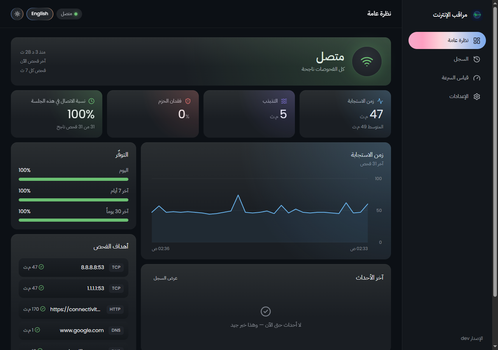
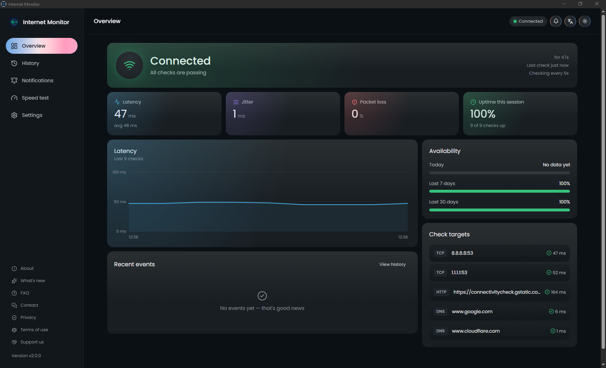
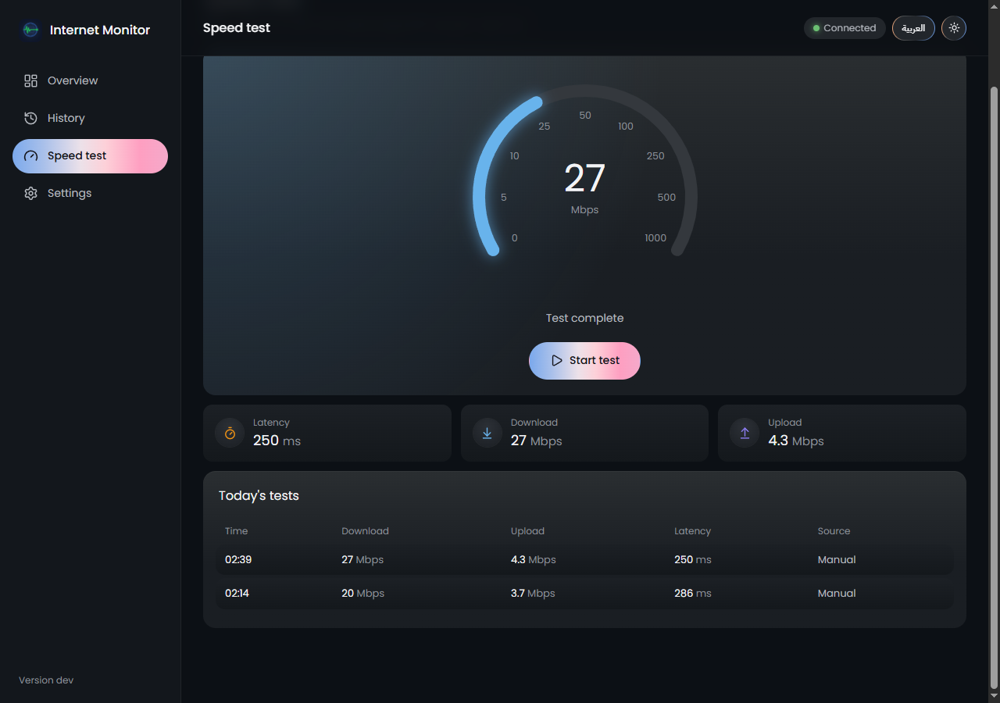
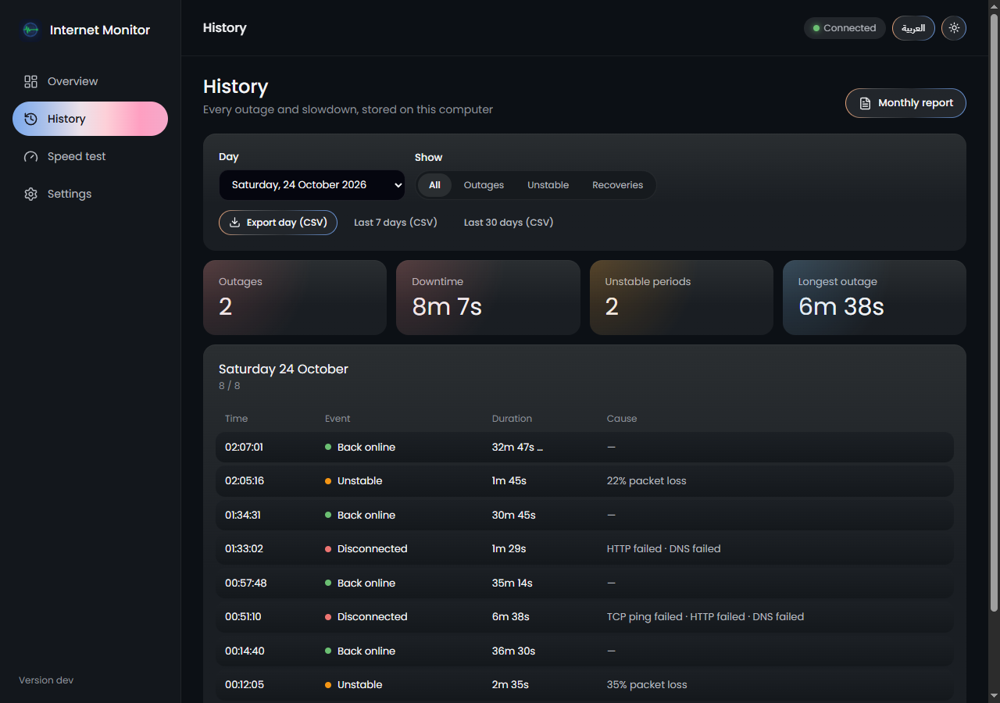
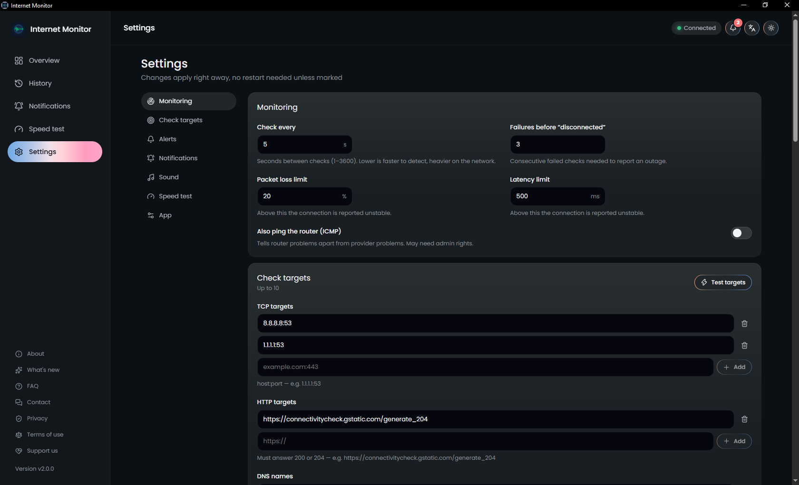

# 🌐 مراقب الإنترنت


[](https://github.com/FutureSolutionDev/internet-monitor/actions/workflows/build.yml)
[](LICENSE)
[](https://go.dev)


> [🇺🇸 Read in English](README.md)

# وثّق انقطاعات الإنترنت، واكسب نزاعك مع مزوّد الخدمة.

**مراقب الإنترنت** أداة مجانية مفتوحة المصدر تلتقط **دليلاً** على كل انقطاع — عشان تبطّل تتكلّم من الذاكرة وتبدأ ترفق أدلة بتذكرة الدعم.

تُسجّل كل انقطاع **بتفصيل لكل طبقة (TCP / HTTP / DNS)** — فتقدر تثبت أشياء مثل *"الـ DNS فشل بينما الخط كان شغّالاً"* — بطوابع زمنية ومدد دقيقة، وتُصدّر **تقريراً شهرياً (PDF)** أو **CSV** نظيفاً تسلّمه لمزوّدك. محلي 100%: بلا حساب، بلا سحابة، بلا تتبّع.

> وهي كمان أداة مراقبة يومية ممتازة — لوحة فورية، اتجاهات latency/jitter، اختبارات سرعة، وتنبيهات Discord/Slack/Telegram.

---











## 💡 لماذا مراقب الإنترنت؟

معظم شكاوى "النت مقطوع" بتفشل لأن مفيش **دليل** — لا أوقات، ولا أسباب، ولا مدد. مراقب الإنترنت بيطلّع الدليل ده:

- **تسجيل لكل طبقة (TCP / HTTP / DNS)** — تثبت *أي* طبقة فشلت، مش بس "كان بطيء" (مثلاً "فشل الـ DNS بينما الخط نفسه كان واصلاً").
- **طوابع زمنية ومدد دقيقة** لكل انقطاع، + نسبة التوفّر الشهرية.
- **دليل قابل للتصدير** — **تقرير انقطاع شهري (PDF)** بضغطة + **JSONL / CSV** ترفقه بالتذكرة.
- **تشخيص الشبكة المحلية مقابل المزوّد** (ICMP اختياري) — تفرّق "الراوتر واقع" من "المزوّد واقع".

## 🧾 كيف تستخدمه ضد مزوّد الخدمة

1. **شغّله** في الخلفية (شريط المهام أو نافذة مستقلة) — بيفحص كل بضع ثوانٍ، 24/7.
2. **سيبه يلتقط الانقطاعات** — كل انقطاع بيتسجّل بسببه (TCP/HTTP/DNS) ووقت بدايته ومدته.
3. **ولّد التقرير الشهري** — افتح لوحة التحكم ← **السجل**، وافتح التقرير الشهري (`/report?month=YYYY-MM`)، اختر الشهر، ثم اضغط **طباعة أو حفظ كـ PDF**.
4. **أرفقه بالتذكرة/الشكوى.** التقرير **محايد افتراضيًا** (يُقرأ كمستندك أنت)؛ ومفتاح "قابل للمشاركة" اختياري يضيف سطرًا صغيرًا لو حبيت.

> نصيحة: فعّل **اختبارات السرعة المجدوَلة** و**تشخيص ICMP (محلي مقابل المزوّد)** لتقوية موقفك بتاريخ latency وjitter والسرعة.

## 👥 لمن هذه الأداة؟

| من | ما يحصل عليه |
| -- | ------------ |
| 🧑 **المستخدم العادي** | دليل لنزاعات المزوّد + إشعارات عند كل انقطاع + قياس سرعة بنقرة |
| 🛠️ **فرق الدعم الفني** | لوحة تحكم كاملة مع سجلات قابلة للتصدير وتقارير PDF شهرية |
| 👨‍💻 **المطوّرون** | تنبيهات Discord / Slack / Telegram ببيانات هيكلية لكل فحص + نقطة `/metrics` لـ Prometheus |

---

## ✨ المميزات

| الميزة | التفاصيل |
| ------ | --------- |
| 🔍 **فحص متعدد الطبقات** | TCP Ping + HTTP + DNS في آنٍ واحد — جميع العناوين قابلة للتخصيص كمصفوفات |
| 📊 **نظرة عامة حية** | حالة الاتصال، وتشخيص بلغة بسيطة (مثل "الراوتر سليم والانقطاع عند المزوّد")، ومخطط زمن الاستجابة، وjitter، وفقدان الحزم، ونسبة التوفّر اليوم / 7 أيام / 30 يوماً، وحالة كل عنوان |
| 🕘 **السجل** | سجل أحداث لكل يوم مع فلاتر وتصدير CSV (اليوم المحدد، آخر 7 أيام، آخر 30 يوماً) |
| ⚡ **قياس السرعة** | قياس تنزيل **ورفع** عبر Cloudflare بعدّاد دائري، ونتائج ping وتنزيل ورفع، وقياسات اليوم، مع تخصيص الاتصالات المتوازية والمدة و**قياسات تلقائية مجدولة** وحد تنبيه عند انخفاض السرعة |
| 🔔 **إشعارات فورية** | Windows Toast + Discord / Slack / **Telegram**، بلغة المستخدم المختارة |
| 🎵 **صوت تنبيه مخصص** | ارفع ملف MP3 أو WAV (حتى 30 ثانية و10 ميجابايت). تعرض الإعدادات هل الصوت المخصص مفعّل ومدته، ويمكنك تجربته بزر **جرّب الصوت** أو **شغّله كتنبيه حقيقي**. وفي التطبيق صوت افتراضي جديد |
| 📋 **سجلات منظّمة** | ملفات JSONL يومية — أحداث الاتصال في `connectivity_DATE.jsonl`، قياسات السرعة في `speedtest_DATE.jsonl` |
| 📄 **التقرير الشهري** | صفحة `/report?month=YYYY-MM` مع زر **طباعة أو حفظ كـ PDF** |
| 🔄 **تحديث تلقائي** | يفحص GitHub Releases (خلفياً + زر **"فحص التحديثات"** يدوي) ويُحدّث بنقرة واحدة مع إعادة تشغيل تلقائية |
| 🌐 **واجهة ثنائية اللغة** | العربية والإنجليزية مع دعم كامل RTL، قابلة للتبديل في أي وقت |
| 🎨 **سمات وشاشات صغيرة** | سمة داكنة وفاتحة، والتصميم يتكيّف مع نوافذ بحجم الهاتف |
| 🖥️ **وضعان للتشغيل** | System Tray (خلفية) + نافذة مستقلة نيتيف |
| 🔒 **نسخة واحدة فقط** | يمنع تشغيل أكثر من نسخة في آنٍ واحد |
| ⚙️ **إعدادات آمنة** | تنبيه عند وجود تغييرات غير محفوظة، وحفظ يتجنّب التعارض (حفظ قديم لا يستبدل إعدادات أحدث) |
| 🛡️ **لوحة محلية فقط** | تستمع على `127.0.0.1` فقط، ومحمية برمز جلسة مختلف في كل تشغيل. رابط الـ webhook ورمز Telegram لا يُرسَلان للمتصفح أبداً |

---

## 🚀 البدء السريع

> **تحذير Windows SmartScreen؟** انقر **"مزيد من المعلومات" ← "تشغيل على أي حال"**. الملف التنفيذي غير موقَّع — الكود المصدري قابل للفحص الكامل أعلاه.

حمّل أحدث ملف تنفيذي جاهز من [**الإصدارات**](https://github.com/FutureSolutionDev/internet-monitor/releases/latest):

| الملف | نظام التشغيل | الوضع |
| ----- | ------------ | ------ |
| `internet-monitor-windows.exe` | Windows 10/11 | System Tray |
| `internet-monitor-gui-windows.exe` | Windows 10/11 | نافذة مستقلة |
| `internet-monitor-macos-arm64` | macOS M1/M2/M3 | System Tray |
| `internet-monitor-macos-intel` | macOS Intel | System Tray |
| `internet-monitor-linux` | Ubuntu/Debian | System Tray |

**Windows — شغّل مرة واحدة، ثم انقر بالزر الأيمن على أيقونة الـ Tray ← فتح لوحة التحكم:**

```bat
internet-monitor-windows.exe
```

**Windows — التثبيت للتشغيل التلقائي عند بدء الجهاز:**

```bat
scripts\install.cmd
```

**macOS / Linux:**

```bash
chmod +x internet-monitor-*
./internet-monitor-macos-arm64
```

افتح لوحة التحكم من **قائمة الـ Tray** (أو من نافذة التطبيق في نسخة GUI).

> لا تقبل لوحة التحكم إلا الطلبات التي تحمل رمز جلسة خاصاً بكل تشغيل. فتح <http://127.0.0.1:8765> مباشرةً في المتصفح يعرض رسالة "افتح من التطبيق" — وهذا سلوك متوقع.

---

## 🧑‍💻 وضع التطوير

تحتاج [Go](https://go.dev/dl/) و[bun](https://bun.sh) (انظر [البناء من المصدر](#️-البناء-من-المصدر)). ابنِ واجهة الويب مرة واحدة ليجد Go ملفات للتضمين:

```bash
git clone https://github.com/FutureSolutionDev/internet-monitor.git
cd internet-monitor
cd web && bun install --frozen-lockfile && bun run build && cd ..
go run ./cmd/tray
```

### العمل على الواجهة مباشرةً (خادم Vite)

والخلفية تعمل، شغّل خادم Vite في نافذة طرفية ثانية. يمرّر `/api` و`/events` و`/notification-sound` إلى `http://127.0.0.1:8765` (غيّره بالمتغير `IM_BACKEND`) ويضيف رمز الجلسة تلقائياً. الرمز هو قيمة `token` في ملف `.session` بجوار الملف التنفيذي الجاري.

```bash
cd web
IM_SESSION=<token> bun run dev
```

في Windows PowerShell: `$env:IM_SESSION="<token>"; bun run dev`.

> نسخة النافذة النيتيف (GUI) تحتاج CGO — انظر [البناء من المصدر](#️-البناء-من-المصدر) أدناه.

---

## 🛠️ البناء من المصدر

### المتطلبات

| الأداة | الإصدار | ملاحظة |
| ------ | ------- | ------- |
| [Go](https://go.dev/dl/) | حسب `go.mod` (حالياً 1.27.3) | مطلوب |
| [bun](https://bun.sh) | 1.3.14 (الإصدار الذي يستخدمه CI) | مطلوب — لبناء لوحة React |
| GCC (يُنصح بـ TDM-GCC) | أي إصدار | اختياري — لنسخة النافذة النيتيف فقط (CGO) |

لوحة التحكم في `web/` تُضمَّن داخل ملفات Go التنفيذية (`web/embed.go`)، لذلك **ابنِها أولاً**. بدون `web/dist` يفشل `go build`.

### واجهة الويب

```bash
cd web
bun install --frozen-lockfile
bun run build
cd ..
```

فحوص أخرى يستخدمها CI: `bun run typecheck` و`bun run lint` و`bun run test`.

### نسخة الـ Tray — لا تحتاج CGO على Windows

```bash
git clone https://github.com/FutureSolutionDev/internet-monitor.git
cd internet-monitor
cd web && bun install --frozen-lockfile && bun run build && cd ..
go build -ldflags="-H=windowsgui -s -w" -o internet-monitor.exe ./cmd/tray
```

### نسخة النافذة النيتيف — تحتاج CGO

تستخدم WebView2 على Windows وWebKitGTK/WebKit على Linux/macOS.

**Windows** — يبني واجهة الويب ثم يُثبّت TDM-GCC تلقائياً إذا لم يكن موجوداً:

```bat
scripts\build-gui.cmd
```

**macOS / Linux** — GCC مثبّت مسبقاً (وعلى Linux تحتاج أيضاً `libgtk-3-dev` و`libwebkit2gtk-4.0-dev`):

```bash
go build -ldflags="-s -w" -o internet-monitor-gui ./cmd/gui/
```

### Makefile

الأوامر `make build` و`make build-debug` و`make build-gui` تعتمد على `make web`، الذي ينفّذ `bun install --frozen-lockfile && bun run build` داخل `web/`.

### السكريبتات المتاحة

سكريبتات `build*.cmd` تستدعي `scripts\build-web.cmd` أولاً.

```text
scripts\build.cmd        بناء الـ Tray exe
scripts\build-gui.cmd    بناء النافذة النيتيف (يُثبّت GCC إذا لزم)
scripts\build-debug.cmd  بناء مع console مرئي (للتصحيح)
scripts\run.cmd          بناء وتشغيل (Tray)
scripts\run-gui.cmd      بناء وتشغيل (نافذة نيتيف — تحتاج GCC)
scripts\stop.cmd         إيقاف النسخة الجارية
scripts\install.cmd      تثبيت في Windows Startup
scripts\uninstall.cmd    إزالة من Startup
scripts\logs.cmd         فتح مجلد السجلات
```

### CI/CD — GitHub Actions

كل push على `master` (وكل pull request) يُشغّل المسار التالي:

```text
Web UI        →  typecheck وlint وtest وbuild (bun 1.3.14)؛ ويرفع web/dist كـ artifact
Quality       →  gofmt وgo vet وgo test وgolangci-lint (يعتمد على Web UI)
Windows Tray  →  cross-compiled على Linux (CGO معطّل)
Windows GUI   →  windows-latest runner
macOS         →  macos-latest (arm64 نيتيف + intel cross-compile؛ Tray وGUI)
Linux         →  ubuntu-22.04 (WebKitGTK 4.0؛ Tray وGUI)
```

تنزّل مهام بناء Go الـ artifact المسمّى `web-dist` بدل إعادة بناء الواجهة.

عند push على `master` يُنشأ tag وإصدار GitHub **فقط إذا نجحت كل عمليات البناء**. تتحقق مهمة الإصدار من وجود الملفات التنفيذية الثمانية، وتنشر معها ملف `SHA256SUMS`.

---

## ⚙️ الإعدادات

يُنشأ `config.json` تلقائياً عند أول تشغيل بقيم افتراضية مناسبة.
عدّله مباشرةً أو استخدم **تاب الإعدادات** في لوحة التحكم.

```json
{
  "check_interval_sec": 5,
  "ping_targets":  ["8.8.8.8:53", "1.1.1.1:53"],
  "http_targets":  ["https://connectivitycheck.gstatic.com/generate_204"],
  "dns_targets":   ["www.google.com", "www.cloudflare.com"],
  "fail_threshold": 3,
  "packet_loss_threshold": 20.0,
  "latency_threshold_ms": 500,
  "log_dir": "logs",
  "webhook_url": "",
  "telegram_bot_token": "",
  "telegram_chat_id": "",
  "dashboard_port": 8765,
  "use_icmp": false,
  "language": "en",
  "speed_test": {
    "download_targets": ["https://speed.cloudflare.com/__down"],
    "parallel_connections": 4,
    "timeout_seconds": 30,
    "upload_target": "https://speed.cloudflare.com/__up",
    "schedule_minutes": 0,
    "alert_threshold_mbps": 0
  }
}
```

| الحقل | الوصف |
| ----- | ----- |
| `ping_targets` | عناوين TCP — يُجرَّب الكل بالتوازي، يكفي نجاح واحد |
| `http_targets` | روابط HTTP — يُجرَّب الأول ثم الثاني عند الفشل |
| `dns_targets` | نطاقات DNS — يُجرَّب الأول ثم الثاني عند الفشل |
| `check_interval_sec` | الثواني بين كل فحص وآخر (1–3600، افتراضي 5) |
| `fail_threshold` | عدد الفشل المتتالي قبل إعلان الانقطاع |
| `log_dir` | مجلد السجلات، نسبةً إلى مجلد التطبيق. تُرفض المسارات المطلقة و`..` |
| `webhook_url` | رابط Discord أو Slack (اتركه فارغاً لتعطيله). يُقبل فقط رابط `https` على نطاقات Discord (`discord.com`, `discordapp.com`) أو Slack (`hooks.slack.com`) |
| `telegram_bot_token`, `telegram_chat_id` | تنبيهات Telegram. تعرض اللوحة الرمز المحفوظ كـ "محفوظ — مخفي" ولا يعود إليها أبداً |
| `dashboard_port` | منفذ اللوحة المحلية (1–65535، افتراضي 8765) |
| `use_icmp` | فحص الراوتر أيضاً بـ ICMP لتشخيص الشبكة المحلية مقابل المزوّد |
| `language` | `en` أو `ar` |
| `speed_test.parallel_connections` | اتصالات متوازية في اختبار التنزيل (1–16، افتراضي 4) |
| `speed_test.timeout_seconds` | مدة اختبار التنزيل بالثواني (5–120، افتراضي 30) |
| `speed_test.upload_target` | نقطة POST لاختبار الرفع (افتراضي Cloudflare `__up`؛ فارغ = تعطيل الرفع) |
| `speed_test.schedule_minutes` | تشغيل قياس سرعة تلقائي كل N دقيقة (0 = معطّل) |
| `speed_test.alert_threshold_mbps` | أرسل Webhook إذا انخفضت السرعة عن هذا الحد (0 = معطّل) |

---

## 📡 الـ Webhooks — Discord وSlack

يُرسل مراقب الإنترنت إشعارات Webhook لثلاثة أنواع من الأحداث:

| المُحفّز | محتوى الـ Payload |
| ------- | ----------------- |
| حدث اتصال (متصل / ضعيف / منقطع) | حالة كل طبقة + فقدان الحزم + المدة |
| اختبار العناوين (من الإعدادات) | زمن الاستجابة ونتيجة كل عنوان |
| نتيجة قياس السرعة | سرعة التنزيل + المدة + زمن الاستجابة |

### Discord — مثال على حدث انقطاع

```json
{
  "username": "Internet Monitor",
  "embeds": [{
    "title": "❌ Internet Disconnected",
    "color": 16007988,
    "fields": [
      {"name": "🔌 TCP Ping",    "value": "❌ Failed", "inline": true},
      {"name": "🌐 HTTP",        "value": "❌ Failed", "inline": true},
      {"name": "🔍 DNS",         "value": "✅ OK",     "inline": true},
      {"name": "📉 Packet Loss", "value": "85.0%",    "inline": true},
      {"name": "⏱️ Duration",    "value": "2m 15s",   "inline": true}
    ],
    "timestamp": "2026-05-11T14:30:00Z"
  }]
}
```

### Discord — مثال على نتيجة قياس السرعة

```json
{
  "username": "Internet Monitor",
  "embeds": [{
    "title": "🚀 Speed Test Completed",
    "color": 2278718,
    "fields": [
      {"name": "📥 Download", "value": "94.3 Mbps", "inline": true},
      {"name": "⏱️ Duration", "value": "10.0s",     "inline": true},
      {"name": "📡 Latency",  "value": "12ms",       "inline": true}
    ]
  }]
}
```

---

## ⚡ قياس السرعة

يستخدم الاختبار المدمج نهج **التنزيل والرفع التكيّفي عبر HTTP**، ويُعرَض حياً على **عدّاد دائري على طراز speedtest.net**:

- يقيس ping ثم **التنزيل** ثم **الرفع** — والعدّاد يتحرك خلال كل مرحلة
- يبدأ بـ payloads صغيرة ويزيد حجمها تدريجياً خلال المدة المُحدَّدة
- يفتح عدة اتصالات متوازية (افتراضي: 4) لاستيعاب الروابط السريعة
- يستخدم **endpoint Cloudflare** (`speed.cloudflare.com`) افتراضياً — لا يحتاج حساباً
- **قياسات تلقائية مجدولة** اختيارية (`speed_test.schedule_minutes`) تبني تاريخ throughput دون تدخّل
- تُحفظ النتائج في `logs/speedtest_DATE.jsonl` (منفصلة عن سجلات الاتصال)
- تُعرض قياسات اليوم في شاشة قياس السرعة، ويمكن تصدير سجل الاتصال كـ CSV من شاشة السجل

> **الخصوصية:** لا تحتوي payloads الاختبار على أي معرّفات للجهاز. تذهب حركة البيانات فقط إلى العنوان الذي تُحدّده في الإعدادات.

---

## 📂 هيكل المشروع

```text
internet-monitor/
├── cmd/
│   ├── tray/                 نقطة الدخول — نسخة الـ Tray
│   └── gui/                  نقطة الدخول — نسخة النافذة النيتيف (CGO + WebView2/WebKit)
├── internal/
│   ├── app/                  التهيئة المشتركة وحارس النسخة الواحدة
│   ├── assets/               الأيقونة المدمجة
│   ├── audio/                التحقق من صوت التنبيه المخصص وتحويله
│   ├── config/               Config والقيم الافتراضية والتخزين وقائمة نطاقات الـ webhook المسموحة
│   ├── core/                 محرك المراقبة + Notifier interface
│   ├── jsonl/                قراءة/كتابة ملفات JSONL اليومية
│   ├── logger/               التسجيل + تنسيق Discord/Slack webhook
│   ├── monitor/              محرك الفحص — TCP / HTTP / DNS / ICMP
│   ├── notifytext/           نصوص الإشعارات المترجمة
│   ├── report/               بيانات التقرير الشهري
│   ├── server/               واجهة HTTP المحلية، بث SSE، رمز الجلسة، الواجهة الثابتة
│   ├── sound/                تشغيل صوت التنبيه
│   ├── speedtest/            محرك قياس سرعة التنزيل والرفع
│   ├── startup/              تسجيل بدء التشغيل مع OS
│   ├── tray/                 أيقونة الـ Tray، القائمة، إشعارات OS
│   ├── types/                الأنواع المشتركة
│   └── updater/              محدّث GitHub Releases
├── web/                      لوحة React 19 + Vite + TypeScript
│   ├── src/                  التطبيق والشاشات (Overview, History, Speed, Report, Settings) والترجمة
│   ├── dist/                 ناتج البناء (يُولَّد)
│   └── embed.go              يضمّن dist/ داخل الملفات التنفيذية
├── scripts/                  سكريبتات البناء والتثبيت والتشغيل (Windows)
├── docs/                     لقطات الشاشة
└── .github/workflows/        build.yml — CI/CD لجميع المنصات
```

---

## 📋 تنسيق السجلات

```text
logs/
  connectivity_2026-05-11.jsonl   أحداث الاتصال (JSON واحد لكل سطر)
  speedtest_2026-05-11.jsonl      نتائج قياس السرعة (JSON واحد لكل سطر)
  app.log                          أخطاء التطبيق وحالة الـ webhook
```

**حدث اتصال:**

```json
{
  "timestamp": "2026-05-11T14:30:00Z",
  "event": "disconnected",
  "duration_seconds": 45.2,
  "reason": {
    "tcp_ping_failed": true,
    "http_failed": true,
    "dns_failed": false,
    "packet_loss_pct": 80.0,
    "avg_latency_ms": 0
  }
}
```

**نتيجة قياس السرعة:**

```json
{
  "timestamp": "2026-05-11T14:35:00Z",
  "event": "speed_test",
  "download_mbps": 94.3,
  "upload_mbps": 18.7,
  "latency_ms": 12,
  "duration_seconds": 9.8,
  "endpoints": ["https://speed.cloudflare.com/__down"],
  "parallel_connections": 4,
  "triggered_by": "user"
}
```

---

## 🤝 المساهمة

كل المساهمات مرحّب بها — بلاغات أخطاء، ميزات جديدة، ترجمات، توثيق.

### 1. Fork والاستنساخ

```bash
git clone https://github.com/YOUR_USERNAME/internet-monitor.git
cd internet-monitor
cd web && bun install --frozen-lockfile && cd ..
```

### 2. إنشاء فرع

```bash
git checkout -b feature/اسم-الميزة
```

### 3. اتفاقية الـ Commits

نستخدم [Conventional Commits](https://www.conventionalcommits.org/) — نوع الـ commit يُحدّد رقم الإصدار تلقائياً:

| البادئة | رقم الإصدار | مثال |
| ------- | ----------- | ----- |
| `feat:` | minor (v1.1.0) | `feat: إضافة وضع الليل` |
| `fix:` | patch (v1.0.1) | `fix: إصلاح timeout على macOS` |
| `BREAKING CHANGE` | major (v2.0.0) | في جسم الـ commit |
| `docs:`, `refactor:` | patch | بدون تغيير وظيفي |

### 4. فتح Pull Request

- اشرح الدافع بوضوح
- أرفق صورة لأي تغيير مرئي
- تأكد من نجاح `go build ./...` و`go test ./...` (ابنِ `web/` أولاً)
- عند تغيير ملفات في `web/` تأكد من نجاح `bun run typecheck` و`bun run lint` و`bun run test`

### مجالات تحتاج مساعدة

- دعم بناء Windows ARM64
- تكامل macOS native menu bar
- مخططات زمن الاستجابة لكل عنوان على حدة
- دعم لغات إضافية

---

## 🗺️ خارطة الطريق

| الميزة | الحالة |
| ------ | ------ |
| ⬆️ قياس سرعة الرفع | ✅ تم |
| 📬 دعم Telegram webhook | ✅ تم |
| ⏰ جدولة قياسات السرعة تلقائياً | ✅ تم |
| 📄 تصدير تقرير PDF (للشكاوى لمزوّد الخدمة) | ✅ تم |
| 🔄 زر "فحص التحديثات" اليدوي | ✅ تم |
| ⚛️ لوحة React (سمات داكنة/فاتحة وتخطيط بحجم الهاتف) | ✅ تم |
| 🪟 بناء Windows ARM64 | 🔜 مخطط |
| 📈 تحليلات لكل مزوّد خدمة وتقارير أسبوعية | 💡 مقترح |
| 🔌 Plugin API لأنواع فحص مخصصة | 💡 مقترح |

---

## 📄 الرخصة

MIT — مجاني للاستخدام الشخصي والتجاري.

صُنع بـ ❤️ بواسطة [FutureSolutionDev](https://github.com/FutureSolutionDev)
